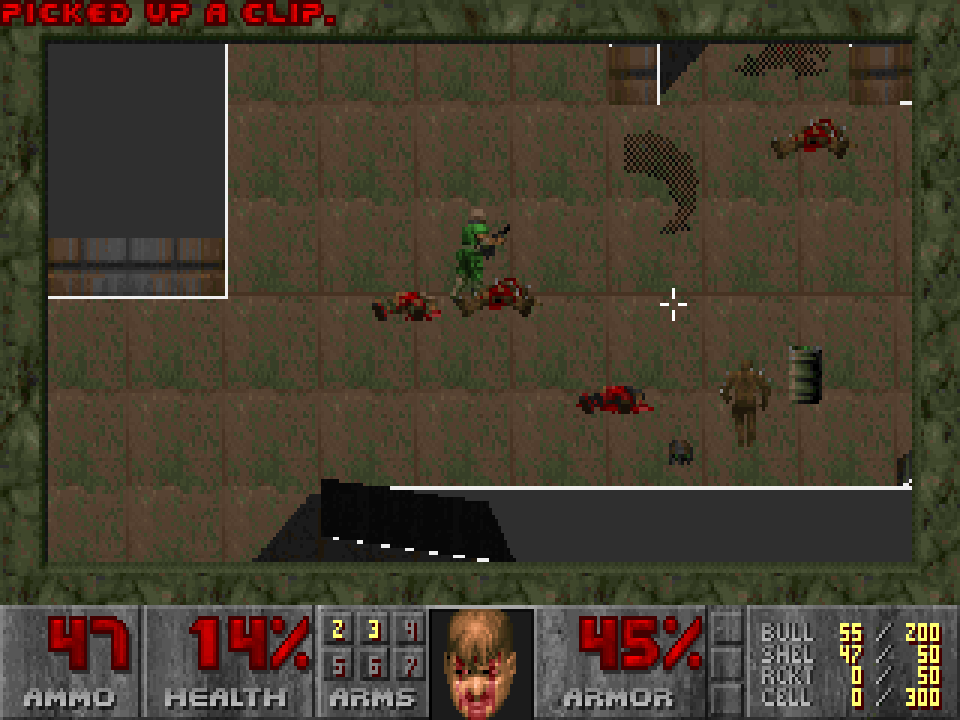
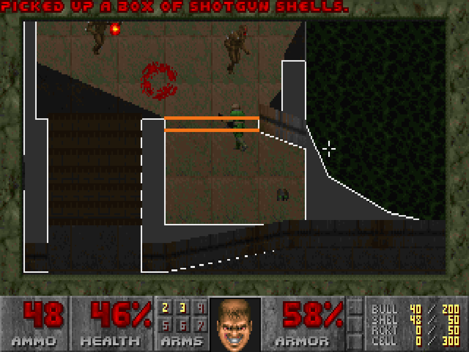
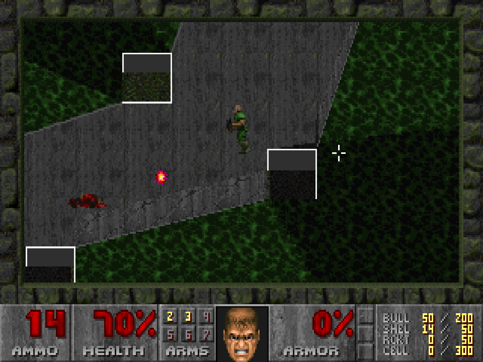

# 2dDOOM

Jouer à **Doom** et **Doom II** en **vue du dessus**, façon *GTA 1/2* : le moteur
de rendu 3D du jeu est remplacé à la volée par un rendu 2D écrit en Rust, et les
contrôles deviennent ceux d'un jeu de tir vu du dessus (clavier pour se déplacer,
souris pour viser).

Le jeu lui-même n'est pas modifié : une bibliothèque est injectée dans
[Chocolate Doom](https://www.chocolate-doom.org/) au lancement et détourne deux de
ses fonctions. Toute la logique de jeu (monstres, physique, armes, sons, menus,
barre d'état) reste celle d'origine.

| Doom | Doom — porte et brouillard de guerre | Doom II |
|---|---|---|
|  |  |  |

Ce projet est la première étape d'une expérience plus large : rendre des jeux 3D
jouables en 2D, notamment sur de petites configurations.

## Fonctionnalités

- **Sols texturés et éclairés** avec les textures et l'éclairage de chaque secteur
  (pièces sombres, lumières qui clignotent, flash des armes, invulnérabilité…).
- **Sprites d'origine** pour les monstres, objets, projectiles et le joueur, avec
  leurs animations et leur orientation réelle (un monstre qui vous tourne le dos
  est vu de dos).
- **Murs en relief** : les murs, marches et portes tournés vers la caméra sont
  dessinés debout avec leur texture.
- **Brouillard de guerre** : ce que votre personnage ne voit pas est assombri, et
  les monstres hors de vue sont cachés.
- **Contrôles « twin-stick »** : déplacement relatif à l'écran, visée à la souris.
- **« Utiliser » automatique** : ouvre la porte ou actionne l'interrupteur le plus
  proche, sans avoir à le viser.
- **Éléments interactifs en couleur** : portes, portes à clé, interrupteurs, sorties.

## Prérequis

- **Linux x86_64**.
- **Rust 1.88 ou plus récent** — installation : <https://rustup.rs>.
- **git, cmake, un compilateur C, pkg-config, SDL2, SDL2_mixer, SDL2_net** —
  `install.sh` peut les installer pour vous (Arch, Debian/Ubuntu, Fedora).
- **Un fichier WAD** (les données du jeu, non fournies) :
  - `DOOM.WAD` / `DOOM2.WAD` de la version Steam (*Ultimate Doom* ou
    *DOOM + DOOM II*) ou GOG ;
  - ou la version shareware gratuite `doom1.wad` ;
  - ou [Freedoom](https://freedoom.github.io), un remplacement libre et gratuit
    (non testé avec ce mod).

## Installation

```sh
git clone https://github.com/evxn13/2dDOOM.git
cd 2dDOOM
./install.sh
```

Si des dépendances système manquent, le script affiche la commande à lancer ; vous
pouvez aussi le laisser les installer (il utilisera `sudo`) :

```sh
./install.sh --deps
```

Le script :

1. vérifie les dépendances ;
2. télécharge et compile **Chocolate Doom 3.1.1** dans `build/` (avec ses
   symboles de débogage, dont le mod a besoin pour trouver les fonctions du jeu) ;
3. compile le mod (`target/release/libdoom2d.so`) ;
4. cherche vos WAD aux emplacements habituels (Steam, Steam Flatpak, GOG,
   `/usr/share/games/doom`…) et enregistre leurs chemins dans `doom2d.conf`.

Si vos WAD sont ailleurs, indiquez-les :

```sh
./install.sh --wad ~/jeux/DOOM.WAD --wad2 ~/jeux/DOOM2.WAD
```

> **Version Steam *DOOM + DOOM II* (2024)** : utilisez les WAD du dossier `base/`
> (`.../Ultimate Doom/base/DOOM.WAD` et `.../base/doom2/DOOM2.WAD`), qui sont les
> versions classiques. Le script les trouve automatiquement.

## Jouer

```sh
./run.sh                      # Doom
./run.sh doom2                # Doom II
./run.sh ~/jeux/autre.wad     # un autre WAD
./run.sh doom2 -warp 7 -skill 4   # options de Chocolate Doom (niveau, difficulté…)
```

### Contrôles

| Action | Touches |
|---|---|
| Se déplacer (haut = vers le haut de l'écran) | **ZQSD** (AZERTY) / **WASD** (QWERTY) ou flèches |
| Marcher au lieu de courir | **Maj** |
| Viser | **souris** (le personnage se tourne vers le viseur) |
| Tirer | **clic gauche** |
| Ouvrir une porte, actionner un interrupteur | **Espace**, **E** ou **clic droit** près de l'élément |
| Changer d'arme | **1** à **7** |
| Carte automatique | **Tab** |
| Menu | **Échap** |

Les touches de déplacement sont lues selon leur **position physique** : ZQSD sur un
clavier AZERTY correspond à WASD sur un clavier QWERTY.

### Lire l'écran

| Couleur | Signification |
|---|---|
| Gris sombre | hors de la carte (« toits ») |
| Trait gris clair | mur |
| Trait gris moyen | rebord trop haut pour être franchi, ou passage fermé |
| Orange | porte |
| Bleu / jaune / rouge | porte qui demande la clé de cette couleur |
| Vert | interrupteur |
| Blanc | sortie du niveau |
| Zone assombrie | hors de la vue de votre personnage |

## Réglages

Les réglages passent par des variables d'environnement, par exemple :

```sh
DOOM2D_ZOOM=3 DOOM2D_FOG=0 ./run.sh
```

| Variable | Effet | Défaut |
|---|---|---|
| `DOOM2D_ZOOM` | unités de carte par pixel (plus grand = vue plus large) | `2` |
| `DOOM2D_MOUSE_SENS` | sensibilité du viseur | `0.5` |
| `DOOM2D_WALL_HEIGHT` | hauteur maximale des murs en relief (unités) | `32` |
| `DOOM2D_FOG` | `0` pour désactiver le brouillard de guerre | activé |
| `DOOM2D_WAD` | WAD à lire pour les graphismes (par défaut celui passé au jeu) | — |

## Dépannage

**Le jeu se lance en 3D normale.** Le mod ne s'est pas activé : le message
`[2dDOOM] adresses : …` n'apparaît pas dans le terminal. Le mod ne reconnaît que
Chocolate Doom 3.1.1 compilé avec ses symboles : lancez le jeu avec `./run.sh`,
après `./install.sh`, et non avec un Chocolate Doom installé par votre
distribution.

**Impossible de viser au pavé tactile en se déplaçant.** La plupart des bureaux
désactivent le pavé tactile pendant la frappe au clavier. Sous **Hyprland**,
`run.sh` désactive ce comportement le temps de la partie puis le rétablit. Sous
GNOME ou KDE, désactivez l'option « désactiver le pavé tactile pendant la frappe »
dans les paramètres de la souris. Le TrackPoint des ThinkPad n'est pas concerné.

**« WAD introuvable ».** Relancez `./install.sh --wad CHEMIN`.

**Une porte ne s'ouvre pas.** Approchez-vous à moins d'un pas (64 unités) et
appuyez sur Espace ou E. Une porte bleue, jaune ou rouge demande la clé de la même
couleur.

## Performances

Mesuré sur la démo `demo1` de Doom (`-timedemo`), même machine, même résolution :

| Rendu | Images par seconde |
|---|---|
| Chocolate Doom d'origine (3D) | 340 |
| 2dDOOM avec brouillard de guerre | 295 |
| 2dDOOM sans brouillard | 307 |

Le rendu complet d'une image prend environ 0,5 ms. À 320×200, le moteur 3D de Doom
est déjà très léger : ce projet ne cherche pas à l'accélérer, mais à valider la
méthode avant de l'appliquer à des jeux plus lourds.

## Limites connues

- Les sprites de Doom n'ont été dessinés que de côté : ils apparaissent « debout »,
  comme dans *Zelda* ou *GTA 2*, et non vus du dessus.
- Seuls les murs dont la face regarde vers le bas de l'écran sont en relief ; les
  autres restent des traits.
- Uniquement Chocolate Doom 3.1.1, sous Linux x86_64. Le multijoueur n'a pas été
  testé.

## Comment ça marche

`run.sh` lance Chocolate Doom avec `LD_PRELOAD=libdoom2d.so`. Au chargement, la
bibliothèque :

1. lit la table des symboles de l'exécutable pour trouver les fonctions et
   variables du jeu ;
2. remplace le début de **`R_RenderPlayerView`** (le rendu 3D) par un saut vers
   son propre rendu, qui dessine directement dans l'image 320×200 du jeu ;
3. remplace, dans la table des fonctions de la boucle principale, le pointeur vers
   **`G_BuildTiccmd`** (qui fabrique la commande du joueur à chaque tic) : la
   fonction d'origine est appelée, puis le déplacement, l'angle et le tir sont
   remplacés selon le clavier et la souris, lus directement dans SDL.

Le rendu lit l'état du jeu dans sa mémoire : la carte (arbre BSP, secteurs,
lignes, faces), les objets (liste chaînée des *thinkers*), les tables des sprites
et des sols animés. Les textures et sprites sont lus dans le WAD.

### Rétro-ingénierie

Les adresses ont d'abord été trouvées sur un binaire **sans symboles**, avec
[REA](https://github.com/morluto/rea) et Ghidra, comme on le ferait pour un jeu
dont on n'a pas le code. Ces résultats servent de solution de secours quand les
symboles sont absents, et documentent la démarche (`mod/src/profile.rs`) :

| Élément | Point de départ |
|---|---|
| `R_RenderPlayerView` | chaîne « R_DrawPlanes: drawsegs overflow », puis l'unique appelant |
| `G_BuildTiccmd` | chaîne « NET GAME » → `G_Ticker` → `RunTic` → relocation dans `doom_loop_interface` |
| Image et zone de vue | `R_InitBuffer` |
| Lignes, secteurs | `P_SpawnSpecials` (« Too many scrolling wall linedefs ») |
| Arbre BSP | `R_PointInSubsector`, `R_Subsector` |
| Sols animés | `R_DrawPlanes` |
| Sprites | `R_ProjectSprite` |

La mise en page de chaque structure lue (`mobj_t`, `line_t`, `sector_t`…) est
vérifiée à la compilation (`mod/src/game.rs`).

## Développement

```
doomwad/   lecture des WAD : lumps, images « patch », textures composées
mod/       la bibliothèque injectée
  lib.rs        initialisation et détours
  profile.rs    adresses du jeu (symboles ou profil REA)
  game.rs       structures de Doom vues depuis Rust
  render.rs     rendu vue du dessus
  visibility.rs brouillard de guerre
  input.rs      contrôles clavier + souris (SDL)
  interact.rs   « utiliser » automatique
tools/
  frame2png     convertit une capture brute en PNG
  xinject       simule clavier et souris (XTest) pour les tests automatiques
```

```sh
cargo test --release      # tests unitaires
```

Variables utiles pour le développement :

| Variable | Effet |
|---|---|
| `DOOM2D_DEBUG=1` | affiche les commandes envoyées au jeu |
| `DOOM2D_PROFILE=1` | affiche le temps de chaque étape du rendu |
| `DOOM2D_DUMP=prefixe` + `DOOM2D_DUMP_FRAMES=100,300` ou `DOOM2D_DUMP_EVERY=35` | capture des images brutes |

Exemple de test sans écran, avec Xvfb :

```sh
source doom2d.conf
DOOM2D_DUMP=/tmp/f DOOM2D_DUMP_FRAMES=600 SDL_VIDEODRIVER=x11 SDL_AUDIODRIVER=dummy \
  xvfb-run -a ./run.sh -timedemo demo1 -nosound
target/release/frame2png /tmp/f-00600.raw "$DOOM_WAD" capture.png 3
```

## Crédits

- *Doom* et *Doom II* © id Software. Aucune donnée du jeu n'est fournie.
- [Chocolate Doom](https://www.chocolate-doom.org/) (GPL-2.0), téléchargé et
  compilé par `install.sh`.
